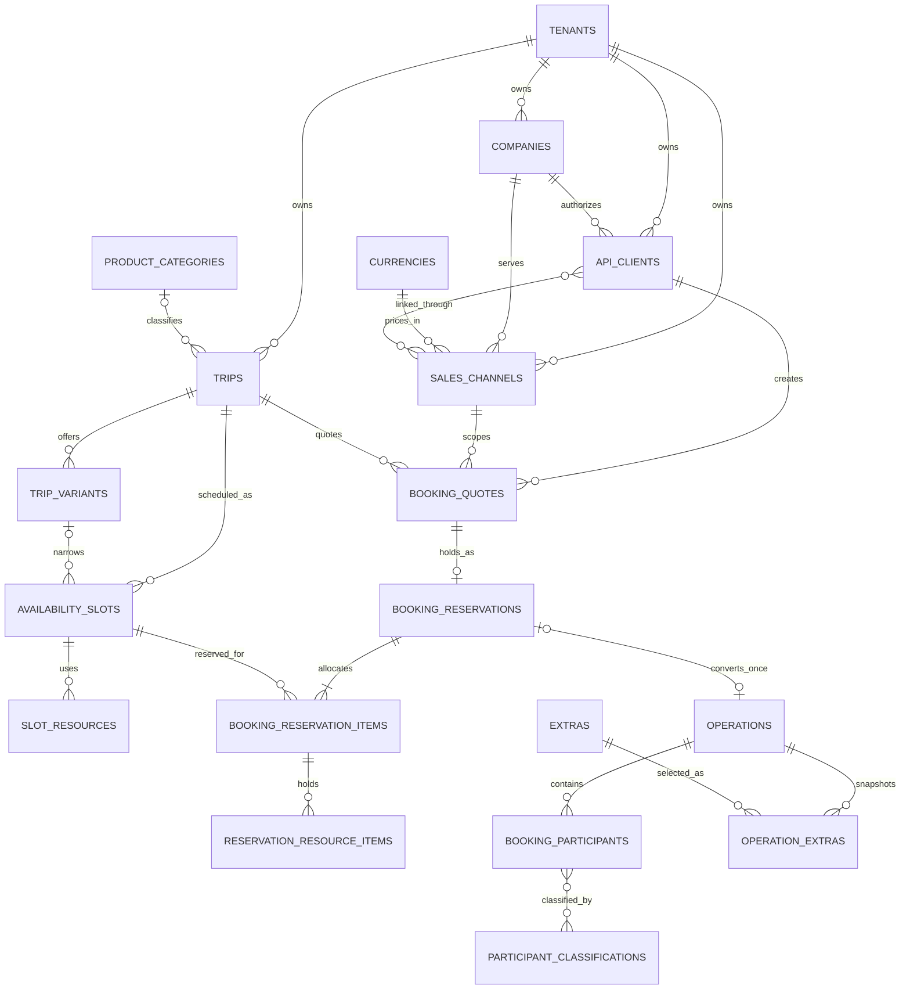

# Extra Fun Diving Club Integration Blueprint

**Status:** Implementation plan only  
**Scope:** ReefOS reusable SaaS transformation for Extra Fun Diving Club  
**Repository:** `Keroles12345/ReefOS`<br>
**Evidence date:** 2026-11-27

## Evidence Legend

- **Verified fact:** confirmed from repository files or executed public-website requests.
- **Observation:** information visible on a public client page, but not yet operationally approved.
- **Recommendation:** proposed architecture or implementation choice.
- **Decision required:** information that must be approved before implementation.
- **NOT VERIFIED:** no reliable repository or public evidence was found.

This document intentionally does not change application code or operational data.

## 1. Executive Summary

ReefOS is a Laravel 13 / PHP 8.3 multi-tenant platform with tenant-scoped trips, companies, currencies, hotels, operations (bookings), extras, prices, resources, payments, and a versioned external API.

The existing system can support the first Extra Fun integration without replacing its booking model. The recommended approach is to extend the existing `Trips` / `operations` / `extras` / `operation_extras` / `prices_company` model with reusable catalog, scheduling, availability, pricing, participant, resource, and diving-operations capabilities.

The highest-priority work is to:

1. preserve existing trip and API behavior;
2. introduce server-authoritative quote and reservation services;
3. make API authentication support multiple clients and server-bound companies/sales channels;
4. add reusable product types and availability/resource reservations;
5. add diving-specific operations while keeping commercial bookings separate;
6. protect sensitive participant and medical data;
7. keep payment creation disabled until a real, tenant-configured provider is available;
8. execute a staged migration with backward-compatible APIs.

Extra Fun is a first tenant-level validation case. No prices or policies found on its website should be hardcoded.

## Architecture Decisions and Trade-offs

These are final target-architecture recommendations for the implementation plan. They are not user approval to implement.

### Decision 1: Keep `trips` as the only canonical product entity

**Verified repository fact:** `trips` is already tenant-owned and contains `name`, `time_trip`, `description`, `status`, `region_id`, `includes`, `excludes`, and `faqs`. `operations.id_trip` has an existing restrictive foreign key to `trips`. `prices_company` and `trips_hotels` also reference `trips`.

**Recommendation:** Do not create a parallel `products` table. Treat each `Trips` row as a bookable catalog product, including diving, course, private-boat, excursion, and other activity types. Add a stable `product_type` discriminator, optional category relation, public identifier, and constrained booking configuration to `trips`. Add `trip_variants` only for independently selectable configurations such as package length or half/full day.

This minimizes data migration: existing trips remain canonical and existing foreign keys continue to work. A future general product abstraction is not justified by current evidence and would create dual identity, synchronization, and migration burden.

### Decision 2: A quote is not a reservation


- `POST /booking-quotes` calculates and stores an immutable price snapshot with a quote expiry. It does not write inventory rows, lock slots, or reduce capacity.
- `POST /booking-reservations` accepts a valid quote, checks the quote's immutable slot selection under transaction/locks, and creates a temporary capacity hold.
- `POST /bookings` requires an unexpired held reservation, creates the legacy `operations` booking, and converts the reservation in the same transaction.

Quote expiry and reservation expiry are separate. A quote may be configured to expire after a short pricing validity window. A reservation gets its own short hold window after it is created. The reservation carries the quote's immutable price snapshot, so quote expiry after reservation creation does not change that held price. If a quote expires before reservation creation, the caller must request a new quote.

Quote validity and reservation-hold duration are separate tenant policies. Their numeric values, allowed ranges, and whether a hold can be extended require owner/client approval; this plan activates no default. A successful idempotent reservation replay returns the same reservation and original expiry; it never extends the hold. A capacity failure rolls back without a hold or successful idempotency record, so the caller may request a fresh quote/reservation after refreshing availability.

### Decision 3: Participant attributes are independent

**Recommendation:** A participant has independent attributes such as age band, activity role, and qualification. A person may be an adult and a diver, or a child and a snorkeler. Do not encode these as one mutually exclusive `participant_category`.

Pricing rules match attribute predicates. A rule can be a base, override, or additive component. The engine selects at most one highest-priority applicable override for a participant and applies each matching additive component at most once. Conflicting equal-priority overrides are a configuration error, not an arbitrary tie-break.

### Decision 4: One reservation ledger accounts for capacity use

**Recommendation:** `availability_slots.capacity` is the configured participant limit for a concrete trip instance. The reservation items are the single source of truth for consumed participant capacity: count an unexpired `held` reservation or a capacity-consuming `converted` reservation once, and do not separately count its `operations` row. Calculate remaining capacity; do not store `remaining_capacity`.

The effective bookable quantity is bounded by the slot limit and every required assigned resource limit. Existing `boats.capacity` remains the boat's source value; staff limits and equipment stock must be explicitly configured and approved because the current schema does not define them. These limits are constraints over the same reservation/allocation transaction, not parallel counters.

All booking paths for a capacity-managed trip use one transaction that locks slots and required resources in stable ID order, rechecks active allocations, then writes reservation items. Typed resource foreign keys are used; no polymorphic `resource_type/resource_id` pair. Boat and staff assignments to overlapping time intervals are rejected at slot publication unless an explicitly approved sharing model is implemented. Multiple parties may share one slot only in its approved shared mode; an exclusive-boat slot permits one active reservation regardless of party size. Equipment quantities are allocated from configured inventory under the same lock protocol.

Advanced dive execution remains later work; the P0 design uses availability slots and does not introduce `diving_sessions`.

### Decision 5: API clients have one company and one or more same-company channels

**Recommendation:**

- One tenant has many companies (verified existing relation through tenant ownership).
- Each sales channel belongs to one tenant, one company, and one shared/global currency.
- Each API client belongs to one tenant and exactly one company.
- An API client may access one or more sales channels, but only channels belonging to its same tenant and company; association is stored in a pivot.
- Each channel has one server-selected currency. The API client does not accept arbitrary currency IDs.
- A multi-company integration gets separate API clients. This keeps company authorization explicit and avoids cross-company scopes.

### Decision 6: Reuse the legacy schema; add only missing booking layers

**Recommendation:** Extend `trips`, `prices_company`, `operations`, and `operation_extras`; reuse `extras`, `trips_hotels`, `boats`, `staff_profiles`, and the existing idempotency table. Add only the channel/client, variant/classification, quote, slot, reservation, and typed resource-allocation structures necessary for the new flow. Do not add a second Products model, separate product option framework, separate extra catalog, generic inventory polymorphism, or a second booking lifecycle.

### Migration implications

- Existing trip, price, booking, hotel and extra identifiers remain unchanged.
- Existing `operations.id_trip` remains required and points to the canonical trip.
- New API routes use public UUIDs, while old API routes retain current identifiers during transition.
- Existing `prices_company` rows remain valid as legacy adult/child/infant pricing; new pricing-rule fields are nullable/additive and the legacy response/calculation path remains explicit.
- No existing operation is backfilled into a new Product. Before a slot becomes bookable, future legacy operations for that trip/date/time must be matched to its capacity and represented in the reservation ledger; ambiguous or unmatched legacy bookings block slot activation until resolved. Historical operations remain untouched.
- No confirmed booking's totals or price snapshot are rewritten.
- New slots are introduced only for trips whose capacity is configured and reviewed. Trips without configured slots remain legacy-only and cannot be advertised as available through the new booking flow.

## Rejected Design Alternatives

| Rejected option | Reason |
|---|---|
| Introduce `products` beside `trips` | Duplicates catalog identity and requires mapping every existing trip, prices, hotels, and operation to two product IDs without a demonstrated requirement. |
| Treat `adult`, `child`, `diver`, and `non-diver` as one category enum | They are independent dimensions; one participant can match multiple pricing conditions. |
| Create a reservation when requesting a quote | Violates the non-blocking quote requirement and allows abandoned quotes to consume inventory. |
| Store `remaining_capacity` as the source of truth | Counters drift under rollback, cancellation, expiry, or duplicate jobs; derive remaining capacity from authoritative reservations under slot locks. |
| Use a generic polymorphic resource ID for boats, staff, and equipment | It cannot have normal foreign keys and can create orphan/cross-tenant references. Use typed nullable FKs with an exactly-one-resource constraint. |
| Add separate product option/value, availability-rule, schedule, pricing, and add-on frameworks immediately | Over-normalizes the first integration. Use trip configuration, variants, existing pricing/extras, and concrete slots; add new normalized structures only when an approved requirement needs them. |
| Automatically bind one legacy tenant key to every company | Preserves an over-broad authority and violates company isolation. Existing company ownership must be mapped and verified before key transition. |
| Keep both `products` and `trips` in dual-write mode | Adds synchronization failure modes and no user-facing value; no planned migration should create duplicate product rows. |
| Build full dive execution, safety records, reporting, and outbound webhooks into P0 | Not required to establish secure catalog-to-booking on the first website; these expand privacy and operational risk before business rules are approved. |

## 2. Current Architecture Assessment

### Verified stack

- PHP `^8.3`
- Laravel `^13.0`
- PHPUnit `^12.5.12`
- Laravel Pint
- Spatie Laravel Permission `^8.3`
- Vite/NPM assets
- Database queues and notifications
- Public and storage-disk file support

The README was not treated as authoritative. Framework versions come from `composer.json`.

### Verified application modules

- Tenant and user management
- Companies
- Trips
- Hotels and trip/hotel pickup mappings
- Customer records
- Operations/bookings
- Extras and operation extras
- Company-specific trip pricing
- Currencies
- Boats, vehicles, drivers, and operation assignments
- Accounting and revenue-account configuration
- Staff operations
- API documentation and an external `v1` API
- Booking lifecycle and status history
- Payment records, refunds, webhook events, and notifications

### Verified tenant architecture

`BelongsToTenant` adds a global tenant scope to model queries and sets `tenant_id` during creation. `TenantContext` tracks the active tenant, and `TenantDatabase` applies tenant predicates and tenant writes to query-builder operations.

The API key middleware authenticates one key stored on `tenants`, initializes tenant context, and applies tenant API scopes. The `api_key_prefix` has a unique index and `api_key_hash` stores a SHA-256 hash; expiry, last-used, and scopes also live on `tenants`. The former encrypted-key column was dropped. `currencies` is global/shared and is not tenant-owned in the inspected migrations. A super-admin tenant with no tenant context is the only identified special-case bypass.

### Verified booking architecture

`POST /api/v1/bookings` accepts trip, company, currency, hotel, date, adult/child/infant counts, customer information, remarks, and an optional idempotency key.

The current implementation:

- validates trip, company, and currency against tenant scope;
- resolves a company/trip/currency price row;
- calculates an adult/child/infant subtotal;
- creates a customer and operation in one database transaction;
- stores a booking ID;
- records a status-history row;
- supports replay of a completed idempotency key.

It does not yet:

- accept diver/non-diver/category data;
- accept selected extras;
- expose a quote endpoint;
- reserve availability or prevent concurrent overbooking;
- support schedules, variants, courses, private boats, or operational dive sessions;
- bind API clients to a company or sales channel;
- support multiple independently scoped API clients per tenant;
- maintain a price snapshot for discounts, taxes, extras, or category pricing beyond operation price columns;
- verify that a supplied company is authorized for the authenticated API client.

### Security and isolation observations

Positive evidence:

- tenant global scope;
- tenant-aware API key authentication;
- tenant API scopes;
- tenant-aware booking lookups;
- tenant-aware idempotency keys;
- row locks for lifecycle and payment operations;
- webhook and payment idempotency records;
- no configured production payment provider in the repository.

Gaps:

- `currencies` is global/shared in the inspected migration evidence;
- tenant API keys are currently stored on `tenants`;
- API booking validation accepts `company_id` and does not associate it with an API client;
- the API exposes all active tenant companies through `GET /companies`;
- price, availability, and booking data lack a complete public API reservation model;
- migration column names in `Prices_company` do not match its model's current `$fillable` names: migrations/controller use `id_company`, `id_trip`, `id_currency`, `price_adult`, `price_child`, `price_infant`, while the model lists `company_id`, `trip_id`, `currency_id`, `adult_price`, `child_price`, `infant_price`. Resolve this discrepancy from live code/tests and the actual target DB before extending pricing;
- the `operations` migration history changes the customer FK name from `id_customer` to `customer_id`; use the final migrated schema, not the initial migration alone;
- API routes and method implementations should be checked against the OpenAPI document before contract freeze.

## 3. Existing Features That Can Be Reused

| Existing capability | Location | Reuse |
|---|---|---|
| Tenant scope trait | `app/Models/Concerns/BelongsToTenant.php` | All catalog and booking entities |
| Tenant context | `app/Support/TenantContext.php` | Request-scoped tenant boundaries |
| Query tenant guard | `app/Support/TenantDatabase.php` | Raw query isolation |
| Trip entity | `app/Models/Trips.php` | Backward-compatible tour base |
| Hotel/pickup entity | `app/Models/Hotel.php`, `Trips_hotels.php` | Pickup-location catalog |
| Company-specific prices | `app/Models/Prices_company.php` | Initial adult/child/infant pricing |
| Extras | `app/Models/Extras.php` | Add-ons and equipment catalog |
| Operation extras | `operation_extras` migration/table | Quantity and price snapshots |
| Booking operation | `app/Models/operations.php` | Keep legacy commercial booking lifecycle |
| Status history | `operation_status_history` | Booking audit trail |
| Idempotency | `tenant_api_idempotency_keys` | Duplicate API request protection |
| Lifecycle | `BookingLifecycleService` | Validated booking transitions |
| Payments/refunds | `PaymentService`, `payments`, `payment_refunds` | Provider-independent payment workflow |
| Webhook records | `payment_webhook_events` | Idempotent payment webhooks |
| Boat and assignment resources | Boat/driver/operation assignment models | Operational implementation starting point |
| API key scopes | `TenantApiScopes` | Legacy scope vocabulary |
| OpenAPI | `public_html/openapi.yaml` | Additive API contract updates |

## 4. Business Requirements

### 4.1 Daily diving trips

**Observation:** Public pages list a 2026-style Diving Price List and a Daily Dive catalog. The price page is not a source of truth for ReefOS and may change:

- single-dive and half-day/boat packages;
- 3, 5, 7, and 10-day boat packages;
- daily and wreck trips;
- private guide and private boat products;
- lunch/drinks and guide included on the listed daily boat packages;
- equipment excluded unless separately rented;
- snorkeling/passenger/child categories.

Exact products, durations, prices, availability, and whether these values remain current require client confirmation.

Required reusable capabilities:

- one or more days;
- 1, 3, 5, 7, 10-day packages;
- diver and non-diver participant categories;
- child and infant categories where configured;
- date and time slot;
- number of dives;
- lunch and included services;
- hotel/pickup selection;
- optional services and rental equipment;
- additional diving days;
- special requirements.

### 4.2 Diving courses

**Observation:** Public pages show Advanced Open Water, Adventure, Discover Scuba Diving, Dive Master, Emergency First Response, Open Water Diver/Referral/Upgrade, Rescue Diver, and specialty courses. The price page additionally shows Scuba Diver, Underwater Navigation, Peak Performance, Wreck, Night, Deep, Nitrox, and Bubble Maker.

The courses section must be modeled as a product subtype, not as hardcoded code branches. The catalog must support course metadata, schedule, certification organization, age/prerequisite/medical rules, seats, required equipment, and instructor assignment.

### 4.3 Private boat trips

**Observation:** Public tours list half-day and full-day private boats with 8-person capacity. A full-day price is visibly fixed for the party in the public catalog.

Support fixed booking prices, per-person, per-hour, per-day, and custom rules. A fixed private-boat price must be independent of passenger count. Capacity is a booking/session constraint.

### 4.4 Other water activities

Support snorkeling, Glass Boat, dolphin, island and wreck excursions, water sports, morning/afternoon/sunset sessions, durations, categories, capacities, pickup, and options.

### 4.5 Extras and equipment

Reuse `extras` and `operation_extras`. Every extra must support category, pricing model, unit price, quantity, availability, required/optional status, applicable products, dates/sessions, and tenant ownership.

**Observation:** The public price page shows full equipment, mask/fins, BCD, regulator, suit, dive computer, torch, air tank, and nitrox tank rental lines. These should be tenant-configured extra records, not hardcoded names or prices.

### 4.6 Cancellation policy conflict

**Observation:** The public Terms page states full refund more than 30 days before activity, 50% within 14-30 days, and no refund within 14 days.

**Observation:** The separate Refund Policy page states free cancellation up to 7 days before, 50% within 7 days, and a full no-show charge.

These public policies conflict and must not be activated automatically. Client approval is required to select or consolidate the cancellation rules, define the refund/reschedule method, and determine whether course/private-boat/excursion rules differ.

## 5. Functional Gap Analysis

| Requirement | Current state | Gap | Priority |
|---|---|---|---|
| Reusable catalog | `trips` is the canonical existing sellable entity | Extend Trips; no parallel Products table; add only categories/variants | P0 |
| Server quotes | No quote endpoint | Persist price snapshot without inventory writes | P0 |
| Availability | No slot-capacity ledger | Add concrete slots and reservation-derived capacity | P0 |
| Concurrent capacity | Not prevented | Slot/resource row locks; all booking paths use same ledger | P0 |
| Participant attributes | Operations store aggregate adult/child/infant counts | Add independent age/activity/qualification classifications | P0 |
| Diver/non-diver | Not modeled | Separate participant activity attribute, compatible with age band | P0 |
| Fixed private pricing | Not modeled | One booking-level pricing component, not multiplied by guests | P0 |
| Extra selection | Staff operation only; extras and operation_extras already exist | Applicability relation, server pricing, operation snapshot | P0 |
| Basic course booking | No course-specific catalog configuration | Configure course as a Trips product and booking variant; advanced cohort/enrollment management is deferred | P0 for website sales; P1 for operations |
| Dive operations | Some boat/resource assignment | Add dive sites/sessions/manifests/equipment allocation | P1 |
| Safety data | Ordinary customers only | Separate encrypted/restricted participant data | P1 |
| API client ownership | One key on tenant | Company-bound API clients with same-company channel pivot | P0 |
| Webhooks | Payment webhooks, no general outbound | Add signed outbound delivery/queue | P1 |
| Cancellation policies | Not modeled | Product/tenant configurable policy | P0 before activation |
| Public booking | Current basic API | Preserve and extend rather than replace | P0 |

## 6. Proposed Target Architecture

### 6.1 Canonical product and catalog

`trips` remains the only canonical product table. Extend it with:

- `public_id` UUID, unique within tenant;
- `product_type` string with a constrained allow-list such as tour, daily diving, course, private boat, excursion, or water sports;
- nullable `product_category_id`;
- nullable, versioned `booking_configuration` JSON for approved type-specific fields, validated by product type on save/read.

Use `product_categories` for tenant-managed catalog grouping. Use `trip_variants` only for actual bookable product alternatives such as course/dive packages or half/full-day boat options. Do not add a separate `products` table, `product_types` table, or general option/value framework.

Existing API trip resources continue to serialize legacy fields. New catalog resources expose public UUIDs, variants, and approved booking configuration.

### 6.2 Pricing and participant data

Keep `prices_company` as the legacy source for existing adult/child/infant trip prices. Extend it additively for new pricing model, variant, channel, unit price, participant-condition JSON, application mode, date validity, active state, and priority. The new API uses the extended rule rows; the old API continues to use the current three price columns. Do not copy every old row into a second pricing table.

Participants are represented individually for the new booking path. Independent classification records (age band, activity role, qualification) can attach to one participant in multiple dimensions. Pricing conditions reference these classification codes. Store only approved participant fields; keep medical/safety data out of P0.

### 6.3 Quote, inventory, reservation, and booking flow

1. The catalog and availability endpoints read active trips, variants, and published slots.
2. A quote request resolves server-side pricing and stores a snapshot without reserving inventory.
3. A reservation request accepts an unexpired quote, reads its immutable slot/participant/extra selection, then locks the resolved slots and configured slot resources in a stable order and holds capacity. The reservation request cannot change quote selections or prices.
4. Booking creation locks the reservation, validates it is still held and unexpired, creates customer/participants and `operations`, snapshots selected extras and totals, then converts the reservation in the same transaction.
5. Cancellation releases a converted reservation only after the lifecycle policy authorizes cancellation.

### 6.4 Domain services

- `PricingEngine`
- `BookingQuoteService`
- `AvailabilityService`
- `ReservationService`
- `BookingCreationService`
- `ApiClientResolver`

These are a small service boundary around new booking behavior. Existing `BookingLifecycleService` and `PaymentService` remain in use. Full diving operations and outbound webhook services are later phases.

### 6.5 Backward-compatible API boundary

Keep current `/api/v1/trips`, `/companies`, `/currencies`, `/bookings`, and payment routes during migration. For migrated clients, `/companies` returns only the bound company and `/currencies` only the configured channel currency; requests must never receive the tenant's full company list or all global currencies. Add catalog, quote, reservation, and public-reference endpoints additively. A capacity-managed trip may not be booked through an old request that omits its slot/reservation; return a clear `409 availability_required` rather than bypassing shared inventory.

## 7. Product and Catalog Data Model

### Canonical entity

One `trips` row represents one sellable product. `product_type` selects configurable capabilities; it does not create parallel tables for each activity. Tenant-specific text, package rules, included services, required fields, and operational configuration live in fields already present or a validated `booking_configuration` document.

### Categories and variants

- A tenant-defined category groups trips for catalog display.
- A `trip_variant` represents a separately selectable package/duration/boat option, not a second product.
- Pricing and availability attach to a trip and optional variant.

### Participant attributes

Participant classifications use dimensions, not a single category:

- age band (for example adult or child);
- activity role (for example diver, non-diver, snorkeler);
- qualification/certification where a product requires it.

The same participant may have one value from an exclusive dimension and multiple compatible values from other dimensions. The server validates age/classification rules and stores the classification snapshot used for a booking.

### Options and extras

Fixed options that do not need independent inventory are stored as validated trip/variant configuration. Equipment and optional priced services reuse `extras`; a new `trip_extras` relationship controls applicability. Selected quantities and unit-price/tax snapshots are stored in the existing `operation_extras`.

## 8. Database Schema Proposal

### Verified schema baseline

The following is verified from the checked migration chain and models:

| Existing table | Verified columns/relationships relevant to this plan |
|---|---|
| `tenants` | Tenant identity/status; tenant API prefix/hash, expiry, last-used, scopes. Encrypted API-key column was subsequently dropped. |
| `companies` | `name`, address, phone, email, status; `tenant_id` added by tenant migration. |
| `currencies` | Global/shared `name`, unique `code`, symbol, exchange rate, default/active flags; no `tenant_id`. |
| `trips` | `name`, `time_trip`, description, status; later `region_id`, `includes`, `excludes`, `faqs`, `tenant_id`. |
| `prices_company` | `id_company`, `id_trip`, `id_currency`, `price_adult`, `price_child`, `price_infant`, `created_at`; later `tenant_id`. No composite uniqueness was found in the creation migration. |
| `hotels` / `trips_hotels` | Hotels have name/address/contact/status; mapping has trip, hotel, pickup time, status and unique `(trip_id, hotel_id)`; tenant IDs were added later. |
| `customers` | Name, email, phone, address, notes; tenant ID added later. |
| `operations` | Legacy trip/company/customer/hotel/currency references; date/time/pickup; adult/child/infant counts and prices; subtotal, extras, discount, tax, total/payment amounts, status, creator. The customer FK was migrated from `id_customer` to `customer_id`. `booking_status` was added later. `tenant_id` was added later. |
| `extras` | Name, price, tax rate and status; tenant ID added later. |
| `operation_extras` | Operation/extra FKs, price, quantity, line total, unique `(operation_id, extra_id)`; tenant ID added later. |
| `boats` | Capacity, name/code/type/registration, active state, ownership/supplier details and tenant ID. `company_id` was removed; boats are not currently company-owned by FK. |
| `staff_profiles` | User FK, optional department FK, phone, position; tenant ID added later. |
| `operation_assignments` | Operation, enum boat/vehicle, untyped `resource_id`, optional `driver_id`, date, uniqueness on operation/type/resource/date; tenant ID added later. It is not a time-range reservation ledger. |
| `tenant_api_idempotency_keys` | Tenant, key hash, request hash, response, optional operation FK, completed time; unique `(tenant_id, key_hash)`. |
| `operation_status_history` | Tenant, operation, status transition, actor/reason and timestamps. |

`BelongsToTenant` scopes tenant-owned models but does not substitute for foreign keys or validation that all related rows share the same tenant. For new tenant-owned tables, use composite foreign keys containing `tenant_id` (and `company_id` where company alignment is part of the authorization boundary) wherever the existing schema permits; add supporting composite unique indexes only after duplicate checks. Where legacy structure prevents a composite FK, enforce tenant agreement in the same transactional write service and test it explicitly. Global `currencies` use their existing global key.

### Existing tables to extend (no duplicates)

#### `trips` — canonical product (extension)

- **Purpose:** the only catalog product entity.
- **Existing fields:** as above.
- **Add:** `public_id` UUID; `product_type` string; nullable `product_category_id`; nullable validated `booking_configuration` JSON.
- **Relationships:** category; variants; slots; existing prices/hotels/images.
- **Tenant ownership:** existing `tenant_id`; backfill/NOT NULL only after checking existing rows and compatibility.
- **FK/deletion:** category FK `RESTRICT` (deactivate rather than delete in-use category); do not change existing trip delete behavior.
- **Indexes/unique:** unique `(tenant_id, public_id)`; `(tenant_id, status, product_type)`; nullable category index.
- **Compatibility:** existing `id_trip` remains canonical and required by legacy operations.

#### `prices_company` — legacy and new pricing rows (extension)

- **Purpose:** preserve current company/trip/currency pricing and support new pricing modes without a parallel pricing table.
- **Existing fields:** `id_company`, `id_trip`, `id_currency`, adult/child/infant amounts, `tenant_id`.
- **Add:** nullable `trip_variant_id`; nullable `sales_channel_id`; `pricing_model` defaulting to legacy category pricing; nullable `unit_price`; nullable participant-condition JSON; `application_mode` (base/override/additive); `priority`; nullable stable `rule_code`; nullable `valid_from`/`valid_until`; active status.
- **Relationships:** existing company/trip/currency, optional variant and sales channel.
- **Tenant ownership:** existing `tenant_id`.
- **FK/deletion:** new variant/channel FKs `RESTRICT`; company/trip/currency retain current restrictive deletion.
- **Indexes:** `(tenant_id, id_company, id_trip, id_currency, trip_variant_id)` and `(tenant_id, sales_channel_id, pricing_model, status, valid_from, valid_until)` as appropriate.
- **Unique:** do not add a uniqueness constraint until existing duplicates and rule semantics are audited; later use a stable rule code unique within tenant/company/trip/currency/channel/variant.
- **Compatibility:** existing rows and legacy amounts are not rewritten; legacy route explicitly selects legacy-model rows.

#### `operations` — booking snapshot (extension)

- **Purpose:** retain existing booking entity and lifecycle.
- **Add:** nullable `booking_reservation_id` with unique constraint; nullable pricing snapshot JSON. Existing total, tax, discount, extra and currency fields remain.
- **Relationships:** existing `id_trip`, `id_company`, `customer_id`, `trip_hotel_id`, currency, payments; new reservation; booking participants and operation extras.
- **Tenant ownership:** existing `tenant_id`.
- **FK/deletion:** reservation FK `RESTRICT`; do not alter existing trip/company/customer deletion behavior.
- **Indexes:** reservation unique; existing tenant/date/status indexes only after query-plan review.
- **Compatibility:** no new `product_id`; `id_trip` remains required.
- **Public identifier:** use the existing generated `booking_id` as the opaque booking reference for new website clients; do not expose the numeric operation primary key.

#### `operation_extras` — selected extra snapshot (extension)

- **Purpose:** existing selected extras and quantity/price snapshot.
- **Add:** nullable tax-rate snapshot if extra tax is used by approved pricing; preserve existing `price`, `quantity`, `amount_total`.
- **Tenant ownership:** existing nullable `tenant_id` from tenant migration; backfill from parent operation and make non-null in a later safe migration after validation.
- **FK/deletion:** existing operation cascade, extra restrict; retain existing unique `(operation_id, extra_id)`.
- **Indexes:** add tenant index only if query evidence requires it; tenant + operation unique can be considered after checking old rows.
- **Compatibility:** do not create another booking-extra table.

#### `tenant_api_idempotency_keys` — existing idempotency store (extension)

- **Purpose:** reuse current request-hash/replay mechanism.
- **Add:** nullable `api_client_id`; existing `response_body`, `response_status`, `request_hash`, and optional `operation_id` store quote/reservation/booking replays.
- **Ownership:** tenant; API-client FK `RESTRICT` or nullable on client archival.
- **Unique:** existing `(tenant_id, key_hash)` retained. Derive new-client hashes with client ID and endpoint namespace so same raw key cannot collide across clients or resource operations.
- **Compatibility:** retain legacy hash behavior for old calls until those clients are migrated.

### New tables (P0 only)

#### `product_categories`

- **Purpose:** tenant-managed catalog labels.
- **Columns:** `id`, `tenant_id`, `name`, `slug`, `status`, timestamps.
- **Relationships:** has many trips.
- **Tenant ownership:** required.
- **FK/deletion:** tenant cascade; trips reference category with restrict.
- **Indexes/unique:** unique `(tenant_id, slug)`; `(tenant_id, status)`.

#### `trip_variants`

- **Purpose:** bookable duration/package options under one trip.
- **Columns:** `id`, `tenant_id`, `trip_id`, `public_id`, `code`, `name`, `configuration_json`, `status`, timestamps.
- **Relationships:** trip, prices, slots.
- **Tenant ownership:** required.
- **FK/deletion:** tenant cascade; trip restrict; referenced variant restrict from price/slot/booking snapshots.
- **Indexes/unique:** unique `(tenant_id, public_id)` and `(tenant_id, trip_id, code)`; `(tenant_id, trip_id, status)`.

#### `participant_classifications`

- **Purpose:** tenant-configurable independent participant attributes.
- **Columns:** `id`, `tenant_id`, `code`, `name`, `dimension`, nullable age bounds, nullable exclusive group, `status`, timestamps.
- **Relationships:** participants and price conditions via classification codes.
- **Tenant ownership:** required.
- **FK/deletion:** tenant cascade; deactivate rather than delete referenced values.
- **Indexes/unique:** unique `(tenant_id, code)`; `(tenant_id, dimension, status)`.
- **Constraints:** no overlapping active age bands in one exclusive group; validated in service and audited before DB constraints.

#### `booking_participants`

- **Purpose:** per-person booking inputs and classifications; replaces no existing table because current operations only store counts.
- **Columns:** `id`, `tenant_id`, `operation_id`, nullable `public_id`, nullable `full_name`, nullable `date_of_birth`, nullable `nationality`, timestamps.
- **Relationships:** operation; many-to-many classification.
- **Tenant ownership:** required.
- **FK/deletion:** tenant cascade; operation cascade; classification pivot cascade.
- **Indexes/unique:** `(tenant_id, operation_id)`; unique nullable `(tenant_id, public_id)`.
- **Privacy:** only collect fields approved by client. No medical fields in this table.

#### `booking_participant_classifications`

- **Purpose:** many-to-many independent age/activity/qualification attributes.
- **Columns:** `tenant_id`, `booking_participant_id`, `participant_classification_id`, timestamps.
- **Relationships:** participant and classification.
- **Tenant ownership:** required.
- **FK/deletion:** tenant/participant cascade; classification restrict/deactivate.
- **Indexes/unique:** unique `(tenant_id, booking_participant_id, participant_classification_id)`.
- **Constraint:** service verifies same tenant and exclusive dimensions.

#### `sales_channels`

- **Purpose:** server-side website/source identity and currency.
- **Columns:** `id`, `tenant_id`, `company_id`, `currency_id`, `code`, `name`, nullable `allowed_origins_json`, `status`, timestamps.
- **Relationships:** tenant, company, shared currency; API clients through pivot.
- **Tenant ownership:** required.
- **FK/deletion:** tenant cascade; composite `(tenant_id, company_id)` FK to companies with restrict; global currency FK with restrict.
- **Indexes/unique:** unique `(tenant_id, code)` and `(tenant_id, id, company_id)` to support tenant/company composite references; `(tenant_id, company_id, status)`.
- **Rule:** currency ID refers to the current global `currencies` table; no currency table duplication or tenant ownership change.

#### `api_clients`

- **Purpose:** multiple independently scoped, rotatable API credentials.
- **Columns:** `id`, `tenant_id`, `company_id`, `name`, globally unique `key_prefix`, `secret_hash`, `scopes_json`, `rate_limit_per_minute`, nullable `expires_at`, nullable `revoked_at`, nullable `last_used_at`, timestamps.
- **Relationships:** tenant, one company, one or more channels through pivot.
- **Tenant ownership:** required.
- **FK/deletion:** tenant cascade; composite `(tenant_id, company_id)` FK to companies with restrict; referenced by quote/reservation/idempotency with restrict or archival behavior.
- **Indexes/unique:** unique key prefix; unique `(tenant_id, id, company_id)` to support tenant/company composite references; `(tenant_id, company_id, revoked_at)`.
- **Secret rule:** reveal generated secret once; store only a hash.

#### `api_client_sales_channels`

- **Purpose:** allow one client to access multiple approved channels for its single company.
- **Columns:** `tenant_id`, `company_id`, `api_client_id`, `sales_channel_id`, timestamps.
- **Tenant ownership:** required; composite references ensure both parents resolve to the same tenant and company.
- **FK/deletion:** composite FKs `(tenant_id, api_client_id, company_id)` and `(tenant_id, sales_channel_id, company_id)`; cascade from either parent.
- **Indexes/unique:** unique `(api_client_id, sales_channel_id)`.
- **Invariant:** API client and channel tenant/company must match; validate in write service and authentication context.

#### `availability_slots`

- **Purpose:** one concrete date/time instance of a trip/variant and its configured participant limit.
- **Columns:** `id`, `tenant_id`, `trip_id`, nullable `trip_variant_id`, `public_id`, `starts_at`, `ends_at`, `capacity`, `status`, timestamps.
- **Relationships:** trip, optional variant, slot resources, reservation items.
- **Tenant ownership:** required.
- **FK/deletion:** tenant cascade; trip restrict; variant restrict; referenced slot restrict.
- **Indexes/unique:** unique `(tenant_id, public_id)`; `(tenant_id, trip_id, starts_at, status)`; `(tenant_id, starts_at)`.
- **Tenant FKs:** trip FK includes `tenant_id`; variant FK includes tenant and trip so the selected variant must belong to this trip.
- **Constraint:** `capacity > 0`, `ends_at > starts_at`; there is deliberately no `remaining_capacity`.

#### `slot_resources`

- **Purpose:** assign typed resources/inventory to a concrete slot.
- **Columns:** `id`, `tenant_id`, `availability_slot_id`, nullable `boat_id`, nullable `staff_profile_id`, nullable `extra_id`, nullable `allocation_mode`, nullable `participant_limit`, nullable `inventory_quantity`, timestamps.
- **Relationships:** slot and exactly one typed resource.
- **Tenant ownership:** required.
- **FK/deletion:** tenant cascade; slot cascade; composite tenant/resource FKs for boat/staff/extra restrict.
- **Indexes/unique:** unique slot+boat, slot+staff, slot+extra (separate filtered constraints or equivalent); `(tenant_id, boat_id)`, `(tenant_id, staff_profile_id)`, `(tenant_id, extra_id)`.
- **Constraint:** exactly one resource FK is non-null. Boat capacity is read from existing `boats.capacity`; each staff row has an Extra Fun-approved `participant_limit`; an inventory-backed extra has an approved `inventory_quantity`. Boat `allocation_mode` is `shared` or `exclusive`; other values and resource limits are configured only where approved. Fields not applicable to that resource type must be null.
- **No polymorphic IDs:** ensures referential integrity.

#### `booking_quotes`

- **Purpose:** non-blocking server-calculated quote snapshot.
- **Columns:** `id`, `tenant_id`, `api_client_id`, `sales_channel_id`, `company_id`, `currency_id`, `trip_id`, nullable `trip_variant_id`, `public_id`, immutable request/selected-slot JSON, pricing breakdown JSON, subtotal/discount/fees/tax/total decimals, `expires_at`, `status`, timestamps.
- **Relationships:** API client, channel, company, shared currency, trip, optional variant; reservation may reference it. Composite tenant/company FKs bind the quote to its client and channel. Slot public IDs in the quote snapshot are resolved and tenant-validated before reservation; reservation items then use actual slot FKs.
- **Tenant ownership:** required.
- **FK/deletion:** tenant cascade; business references restrict. Never delete a quote while a reservation/booking references it.
- **Indexes/unique:** unique `(tenant_id, public_id)`; `(tenant_id, api_client_id, expires_at, status)`.
- **Inventory:** no capacity or resource rows created by quote.
- **Idempotency:** optional `Idempotency-Key`; key/body scoped to client and endpoint. Same request replays the quote and original expiry; changed body conflicts; an expired quote replay stays expired.

#### `booking_reservations`

- **Purpose:** temporary hold and later conversion marker.
- **Columns:** `id`, `tenant_id`, nullable `api_client_id`, nullable `booking_quote_id`, `public_id`, `source` (`api`, `legacy_migration`), `status` (`held`, `converted`, `expired`, `released`), nullable `expires_at`, nullable `converted_at`, timestamps.
- **Relationships:** quote, reservation items, optional operation via `operations.booking_reservation_id`.
- **Tenant ownership:** required.
- **FK/deletion:** tenant cascade; client/quote restrict when present; operation relation restrict.
- **Indexes/unique:** unique `(tenant_id, public_id)`; `(tenant_id, status, expires_at)`; one converted booking per reservation enforced by unique nullable `operations.booking_reservation_id`.
- **Quote uniqueness:** unique nullable `booking_quote_id`, so one quote can produce at most one successful hold while legacy-migrated reservations may have no quote.
- **Idempotency:** request key lives in the existing idempotency store with client/endpoint-scoped hash and canonical request hash.
- A failed capacity attempt creates no hold; the caller must request a fresh quote if availability changes or the hold expires.
- **Legacy rows:** future legacy operations matched to a slot are represented as `source=legacy_migration`, `status=converted`, with corresponding reservation items and no quote/client. `expires_at` is null for converted rows.

#### `booking_reservation_items`

- **Purpose:** hold one or more slot quantities atomically.
- **Columns:** `id`, `tenant_id`, `booking_reservation_id`, `availability_slot_id`, `quantity`, timestamps.
- **Relationships:** reservation, slot, resource reservation items.
- **Tenant ownership:** required.
- **FK/deletion:** reservation cascade; slot restrict.
- **Indexes/unique:** unique `(booking_reservation_id, availability_slot_id)`; `(tenant_id, availability_slot_id, booking_reservation_id)`.
- **Constraint:** `quantity > 0`.

#### `reservation_resource_items`

- **Purpose:** hold equipment quantities selected for a reservation against an assigned `slot_resources` row. Boat and staff time allocations are represented by the slot's typed assignments and checked for interval conflicts; passenger counts are not copied into a second resource counter.
- **Columns:** `id`, `tenant_id`, `booking_reservation_item_id`, `slot_resource_id`, `quantity`, timestamps.
- **Relationships:** reservation item and slot resource.
- **Tenant ownership:** required.
- **FK/deletion:** reservation item cascade; slot resource restrict.
- **Indexes/unique:** unique `(booking_reservation_item_id, slot_resource_id)`.
- **Constraint:** `quantity > 0` and no more than available allocated equipment quantity after active holds.

#### `trip_extras`

- **Purpose:** determine which existing extras apply to a trip/variant.
- **Columns:** `id`, `tenant_id`, `trip_id`, `extra_id`, `is_required`, nullable `configuration_json` for variant/date/session eligibility and approved price overrides, timestamps.
- **Relationships:** trip and existing extra. Configuration references are validated against the tenant's variants and slots.
- **Tenant ownership:** required.
- **FK/deletion:** tenant cascade; trip/extra restrict.
- **Indexes/unique:** unique `(tenant_id, trip_id, extra_id)`; `(tenant_id, extra_id)`.
- **No duplicate catalog:** names, base price, tax and active state stay in `extras`.

### Deferred tables and explicit non-additions

- No `products`, `product_types`, `product_options`, `product_option_values`, `product_pricing_rules`, `product_availability_rules`, `product_schedules`, `time_slots`, `product_reservations`, or `product_addons`.
- No new payment, refund, lifecycle, or outbound webhook tables in P0; current payment and lifecycle structures remain.
- No dive sites, diving sessions, safety records, or equipment-allocation execution tables in P0.
- No cancellation-policy table until Extra Fun confirms the conflicting website terms and refund rules.
- No new currency table; `currencies` remains the shared source.

## 9. Pricing Engine Design

All prices are resolved server-side from the authorized tenant, company, sales channel, shared currency, trip/variant, date, and participant attributes. The API rejects or ignores client-supplied amounts.

The existing `prices_company` adult/child/infant fields remain the legacy pricing path. The extended row supports configurable models such as fixed booking, per-person, per-day, per-hour, package, and participant-conditioned price components. Rule evaluation is deterministic:

1. match tenant/company/channel/currency/trip/variant/date conditions;
2. validate participant classifications independently by dimension;
3. apply the single highest-priority matching override per participant;
4. apply each matching base/additive component once;
5. apply extras and configured discounts/fees/tax;
6. round with one documented currency precision policy.

A fixed booking price is a single booking component and is never multiplied by passenger count. The quote stores a complete line-level snapshot (rule identifiers, labels, quantity, unit amount, tax, and total). A reservation and resulting operation reference that immutable snapshot. Editing current pricing affects only future quotes.

The response includes base/participant lines, variant/package charges, selected extras, discount, fees, tax, currency, total, and expiration. No public amount field is trusted.

## 10. Availability and Resource Management Design

A published `availability_slots` row represents one concrete bookable trip/variant instance. Its `capacity` is the configured participant limit, while reservation items are the sole ledger of consumed participant capacity. Remaining capacity is calculated from that limit and active, unexpired holds plus converted reservations whose bookings have not released inventory. It is never stored as an authoritative counter, and the linked `operations` row is not counted a second time.

Slots are explicit, not inferred from a trip existing. No published eligible slot means unavailable. Recurring schedule generation and calendar rules are intentionally out of P0.

### Quote and reservation semantics

- **Quote:** does not lock or reserve inventory; it may be issued even when no capacity remains, but its response must report availability as unavailable and reservation then fails. Quote validity is independent of inventory.
- **Reservation:** requires an unexpired quote; inserts a temporary hold only after current slot and resource capacity is rechecked. A quote may produce at most one successful reservation; the client requests a new quote after a failed or expired attempt.
- **Expiration:** quote and reservation expiry are separate persisted timestamps, evaluated against one trusted UTC server clock. The hold has its own approved TTL; it is not extended by replay. A quote's price snapshot remains fixed for the lifetime of a valid reservation, even if the quote itself later expires. TTL values and any extension policy require owner/client approval and are not defaults in this plan.
- **Expired holds:** availability ignores them immediately when `expires_at <= now`; a scheduled worker may mark them `expired`, but cleanup is not part of correctness.
- **Conversion:** booking creation atomically locks the held reservation and converts it; expired or released reservations return `410`/`409` and cannot create bookings.
- **Cancellation:** only an authorized lifecycle transition releases converted inventory; payment state does not silently release a confirmed booking.

### Concurrency

For a reservation with one or multiple slots, begin a database transaction, lock slot rows and assigned resource rows in ascending primary-key order, calculate current held+converted allocations, validate capacity and resource requirements, then persist reservation header/items. Any failure rolls back every slot hold. Booking conversion locks the reservation, verifies `held` and `expires_at > now`, creates the existing operation and converts the reservation atomically. A unique nullable `operations.booking_reservation_id` prevents converting one reservation twice.

Every new and legacy booking path must use the same capacity logic for capacity-managed trips. Legacy booking payloads without a slot/reservation receive `409 availability_required` for those trips; they must not bypass the ledger.

Idempotency keys are hashed and scoped by tenant, API client, endpoint, and canonical request body. The existing tenant idempotency table can be reused by deriving a scoped key hash; do not create a duplicate idempotency system unless schema evidence proves reuse is unsafe. Same key/same body replays the original result and original expiry. Same key/different body returns `409`. Replaying an expired hold does not renew or recreate it; the client must issue a new quote and reservation key. Database uniqueness resolves concurrent first-use races.

### Boats, instructors, and equipment

- A slot's typed `slot_resources` link assigns boats, staff profiles, and inventory-backed equipment (`extras`) without a polymorphic ID.
- Publishing or changing a slot locks its resource rows and rejects overlapping boat/staff assignments by actual `[starts_at, ends_at)` interval, not merely by operation date. Any turnaround buffer is a client decision.
- Shared-boat slots allow multiple reservation items against the same slot, bounded by `min(availability_slots.capacity, boats.capacity)` and any approved instructor limit. An exclusive-boat slot allows only one active hold/converted booking for the boat interval, regardless of party size. A boat cannot be assigned to another overlapping slot.
- Instructor assignments are exclusive across overlapping slots until Extra Fun approves a concurrent staffing model and ratios. No instructor ratio is inferred from current schema.
- A dive session is represented by an availability slot for P0. A separate `diving_sessions` table is deferred unless the website integration proves it is required.
- Equipment add-ons consume quantities only when configured as inventory-backed. `extras` currently supplies catalog/price data, not verified stock counts; unavailable stock evidence blocks inventory-backed extras.
- Each reservation item consumes participant quantity once; resource claims are checked in the same transaction. The slot's effective availability is the minimum remaining limit across the slot and its required resources.
- Resource assignment and reservation share one transaction and tenant validation. Existing `operation_assignments` is not used as inventory because it stores day-level assignments and an untyped resource ID, not interval capacity.

## 11. Diving Operations Module Design

Advanced dive execution remains a later capability, separate from the first catalog-to-booking integration. Existing boats and staff profiles are reusable resources, but current `operation_assignments` is day-level and not sufficient for concurrent time-slot locking.

When approved, introduce dive sites, diving sessions, manifests, instructor/divemaster assignments, equipment allocations, and logs as operational records linked to a booking. Do not equate `operations` with dive execution, and do not add `diving_sessions` or sensitive safety tables to the P0 schema. P0 slot resource allocation supports required boat/staff/equipment availability without pretending it is a full dive log system.

## 12. Customer and Safety Data Design

Ordinary booker data remains in existing `customers`; per-participant names/classifications may be stored in the proposed P0 `booking_participants` table. Do not collect participant medical or safety information until Extra Fun confirms fields, consent wording, access roles, retention, and deletion policy. A later restricted safety table is not included in the P0 schema.

Required controls:

- collection only where configured for the product;
- dedicated medical/safety authorization;
- no sensitive fields in general booking API resources or logs;
- encrypted document metadata or content storage;
- signed storage URLs with short expiration;
- consent timestamp and version;
- configurable retention and deletion;
- audit-log access;
- client-approval of medical rules;
- no invented clinical eligibility rules.

General `/bookings/{id}` responses may expose presence/status only, not medical detail.

## 13. API Authentication and Tenant Isolation Design

### Exact relationship and authority

```text
Tenant 1 ── * Company
Tenant 1 ── * SalesChannel
Company 1 ── * SalesChannel
Currency 1 ── * SalesChannel     (currencies is shared/global)
Tenant 1 ── * ApiClient
Company 1 ── * ApiClient
ApiClient * ── * SalesChannel    (api_client_sales_channels; same tenant/company only)
```

An API client has exactly one tenant and one company. It may access multiple sales channels for that same company. Every channel has one configured currency. The request selects an authorized channel using a public channel code/header; the server resolves its company and currency. `company_id` and `currency_id` in a request are either omitted or must match the resolved binding. They never select authority.

The tenant-owned companies, API clients, and channels are checked on every request. Because `currencies` is global, every supplied/configured currency reference is validated for active state and channel association. A currency cannot be used merely because it exists.

Allowed origins are a CORS/browser policy only, not client authentication: callers can forge the `Origin` header. Public website integrations should use server-to-server requests and never expose the secret in JavaScript.

Credential rotation creates a new client secret, displays it once, allows a brief tenant-approved overlap, verifies use of the new secret, then revokes the old credential. Revocation is immediate for new requests; historical quote/booking records remain readable under the tenant's retention policy.

### Legacy key transition

**Verified:** the current key prefix/hash/expiry/last-used/scopes are stored on `tenants`; the plaintext secret is not stored; an encrypted-key column was dropped. Current key authority spans the tenant and API calls can supply `company_id`.

**Safe migration recommendation:**

1. Inventory tenants, key expiry/scopes, API usage, active integrations, and tenant companies. Do not copy raw keys or expose hashes.
2. Ask each tenant to assign every integration to exactly one company and one or more channels.
3. If a tenant has exactly one company and one confirmed integration, the existing prefix/hash can be moved to one API-client row in a reversible additive migration without revealing the raw secret; bind it to the explicitly approved company/channel and verify its scope. Alternatively, rotate and issue a new secret.
4. If a tenant has multiple companies or integrations, do not copy the same hash into several clients. Issue separate new secrets per company/client because the existing secret cannot be split into independently revocable credentials.
5. Configure the new API client and validate catalog, quote, reservation, and booking in a test environment.
6. Keep the legacy key path only for identified integrations during a time-bounded transition. Do not silently map a multi-company key to every company.
7. **Current working-tree containment (implemented and focused-tested; not deployed):** company-sensitive legacy endpoints now fail closed unless exactly one company row belongs to the tenant and that company is active; a second inactive/historical row also blocks access. Request handling is bound to the sole active company. Catalog pricing, company listing, booking/status/payment/refund lookups, and booking idempotency replays are constrained to that company; zero, multiple, or inactive-only configurations receive `403 legacy_api_company_binding_required`. The legacy key is still stored at tenant level and is not persistently bound to a client/channel. This guard is transitional containment, not the final client authorization model; owner mapping and migration to independently revocable API clients remain required. Shared/global currencies retain their existing scope. Do not clone one legacy hash into multiple API clients.
8. Revoke the tenant key only after the tenant confirms cutover and telemetry shows no remaining legitimate use. Delete legacy columns only in a later approved migration.

The one-tenant-key-to-many-company model cannot be converted into multiple independent secrets without reissuing credentials. A single-company tenant can retain its current secret by moving the existing hash/prefix to one client after explicit mapping. A hash copied to several clients would preserve shared authority and would not provide independent revocation.

Every new route requires a valid client, scope, active tenant/company/channel, and matching tenant ownership. Public resources use UUID/reference IDs; tenant-local identifiers may remain in legacy routes.

## 14. Public API Contract

### Common request rules

- Every endpoint requires `Authorization: Bearer <api-client-secret>` and the required client scope.
- If an API client has multiple channels, the request supplies `X-Sales-Channel` with a public channel code. If it has exactly one channel, the server may infer that channel.
- The channel must be linked to the client and match its tenant/company. The server resolves currency from that channel.
- New endpoints accept public UUIDs/references; they do not accept client-selected tenant, company, or currency as authority.
- Responses use one standard JSON error shape with field errors for validation; `401`, `403`, `404`, `409`, `410`, `422`, and `429` semantics are consistent across endpoints.

### Catalog

#### `GET /api/v1/catalog/categories`

- Scope: `catalog:read`
- Request: no body, pagination optional.
- Response: active categories with at least one product visible to the authenticated channel.
- Validation: pagination.
- Errors: `401`, `403`, `429`.
- Restriction: tenant and sales-channel visibility.

#### Legacy `GET /api/v1/companies` and `GET /api/v1/currencies`

- Scope: existing legacy scopes during transition.
- For requests authenticated as an explicitly migrated API client, response is limited to its bound company and authorized channel currency.
- Requests still authenticated by the legacy tenant key use the temporary exactly-one-active-company guard on company-sensitive endpoints; zero, multiple, or inactive-only company configurations receive `403 legacy_api_company_binding_required`. This does not provide persisted client/channel identity or a deprecation deadline. New API-client routes must never use tenant-wide company authority.
- Errors: `401`, `403`, `429`.
- Restriction: never expose tenant-wide company/currency data through a new client-bound integration.

#### `GET /api/v1/catalog/products`

- Scope: `catalog:read`
- Request: optional category/type/date and pagination; company is not client-selectable.
- Response: `data[]` representing canonical `trips`, with public ID, product type, category, variants, display fields, and bookability state.
- Validation: date; enums; pagination.
- Errors: `400`, `401`, `403`, `429`.
- Restriction: tenant, sales channel, company, active status.

#### `GET /api/v1/catalog/products/{public_id}`

- Scope: `catalog:read`
- Response: product details, variants, configured options/add-ons, and published availability references.
- Errors: `404`, `401`, `403`.
- Restriction: no records outside tenant/client channel.

#### `GET /api/v1/catalog/products/{public_id}/options`

- Scope: `catalog:read`
- Response: validated trip/variant configuration, participant attribute definitions, applicable extras and required fields.
- Errors: `404`, `401`, `403`.
- Restriction: client channel and tenant.

### Availability

#### `GET /api/v1/availability`

- Scope: `availability:read`
- Request: product, optional variant, date range, participant counts and requested extras; no company/currency selector.
- Response: published public slot IDs, start/end, calculated available quantity, bookable flag. Capacity is read-only.
- Errors: `400`, `404`, `401`, `403`.
- Restriction: server-resolved channel/company/currency.

#### `GET /api/v1/products/{public_id}/availability`

- Scope: `availability:read`
- Request: date, variant, start time optional.
- Response: matching slots and calculated availability. No hold is created.
- Errors: `400`, `404`, `409`.

### Quote

#### `POST /api/v1/booking-quotes`

- Scope: `quotes:create`
- Request:
  - canonical trip/public ID;
  - variant/public ID optional;
  - activity date (required for date-based pricing);
  - selected slot public ID(s) when the activity is session-based (these are quote inputs only, not holds);
  - participant records/attributes or quantities where individual details are not yet required;
  - option selections;
  - extras and quantities;
  - pickup location/public ID optional;
- Response:
  - quote public ID;
  - full price breakdown;
  - currency;
  - quote expiration;
  - informational availability only, clearly not a guarantee or hold;
  - required participant fields.
- Validation: active trip/variant, API client channel, participant attribute compatibility, pricing rule resolution, extra eligibility, date shape. If a date or slot is needed to price, it is included but does not reserve it.
- Errors: `400`, `422`, `404`, `401`, `403`.
- Restriction: server-calculated price; client prices ignored/rejected.
- Idempotency: optional `Idempotency-Key`; same key/body returns the same quote and expiry; changed body returns `409`; expired replay remains expired.

#### `POST /api/v1/booking-reservations`

- Scope: `reservations:create`
- Request: quote public ID only; participant counts, slot IDs, options, extras, company, and currency are inherited from the immutable quote.
- Response: reservation public ID, `held` status, expiration, slot lines and price snapshot reference.
- Validation: quote belongs to client/channel; quote is unexpired; every selected slot still belongs to the quoted product/variant/date; quantities and selected inventory-backed extras remain within current configured limits.
- Errors: `401`, `403`, `404`, `409 capacity_unavailable`, `410 quote_expired`, `422`.
- Concurrency: one transaction and locks all slots/resources in stable order. No partial reservation on multi-slot failure.
- Idempotency: `Idempotency-Key` required. Same key/body replays the same reservation; changed body returns `409`; replay does not renew expired hold.

### Existing and new booking endpoints

#### `POST /api/v1/booking-reservations/{public_id}/booking`

- Scope: `bookings:create`
- Converts a held reservation into the existing `operations` booking. Customer details and any approved participant fields are submitted here; they cannot change the quote's price, product, or capacity selection.
- Requires `Idempotency-Key`. The existing `POST /api/v1/bookings` remains the legacy contract during migration and is not overloaded with a second request shape.
- Response: public booking reference, status, amount, currency, immutable price breakdown.
- Validation: reservation is held, unexpired, owned by this API client/channel/company, and unused. Participant count/classifications and extras must match the quote; participant personal details may only fill configured fields and cannot change price or capacity.
- Errors: `422`, `409`, `410`, `401`, `403`.
- Atomicity: lock reservation, create customer/operation/participants/operation extras, snapshot totals and convert reservation in one transaction.
- Idempotency: same canonical body replays the original booking; changed body conflicts; unique operation reservation reference prevents a second booking.

#### Legacy `POST /api/v1/bookings`

Preserve the current request and response for trips not yet capacity-managed. Once a trip is enabled for slots, reject legacy requests that do not reference the reservation flow with `409 availability_required`; no staff/API path may bypass the shared ledger.

#### `GET /api/v1/bookings/{public_reference}`

- Scope: `bookings:read`
- Response: booking, customer summary, participant summary, price snapshot, payment status.
- Errors: `404`, `401`, `403`.
- Restriction: no sensitive safety fields.

#### `POST /api/v1/bookings/{public_reference}/confirm`

- Scope: `bookings:manage`
- Response: confirmed booking and lifecycle history.
- Errors: `409`, `422`, `404`.

#### `POST /api/v1/bookings/{public_reference}/cancel`

- Scope: `bookings:manage`
- Request: reason and optional refund request.
- Response: new status/refund estimate.
- Errors: `409`, `422`, `404`.

#### Legacy `PATCH /bookings/{booking}/status`

Remain available during migration. Route future status changes through `BookingLifecycleService`.

### Payments

Payment endpoints remain disabled until provider configuration is verified. The existing `/payments` and `/refund` routes must preserve provider and tenant isolation.

## 15. Webhook Architecture

P1 outbound events:

- `booking.created`
- `booking.confirmed`
- `booking.cancelled`
- `booking.updated`
- `payment.succeeded`
- `payment.failed`
- `payment.refunded`
- `availability.changed`

Use queues and delivery records. Sign each payload with HMAC/SHA-256 and include event ID, timestamp, delivery ID, tenant-neutral public booking ID, and a signature header.

Retry with exponential backoff and a bounded attempt count. Verify webhook delivery signatures and provider event IDs independently. Never trust a provider callback without signature and provider-specific verification.

## 16. Payment Integration Design

Keep the `PaymentGateway` abstraction and `UnconfiguredPaymentGateway`. No fake success is allowed.

Provider configuration must be tenant-aware. Store no global payment secret for tenant-specific providers.

Payment confirmation must update both payment and booking state atomically according to lifecycle rules:

- pending payment intent;
- succeeded payment;
- partially refunded;
- refunded;
- failed/canceled.

Refund policies are separate from payment status. Cancellation fees and partial refunds require client approval.

## 17. Booking Lifecycle

Keep quote state (`valid`, `expired`) on `booking_quotes` and reservation state (`held`, `converted`, `expired`, `released`) on `booking_reservations`. Neither quote nor hold is a booking lifecycle status.

The target booking lifecycle uses `pending`, `confirmed`, `completed`, and `cancelled`; refund state remains in payments/refunds. The existing `paid` and `refunded` booking-status values must remain readable during migration because the current lifecycle uses them. Do not silently rewrite old rows or change existing transition rules until a compatibility migration is designed.

Allowed booking transitions remain enforced by `BookingLifecycleService`; every transition records actor, tenant, time, previous status, next status, and reason. Payment state and operational state remain separate. Diving-session state belongs to the later operations module.

## 18. Admin Dashboard Changes

P0 dashboard work is limited to secure API client/channel configuration, trip/category/variant configuration, pricing and extras, explicit slot/resource setup, and booking/reservation inspection. Reporting and full operational dive boards are deferred.

### Catalog management

- Trips-as-products, categories, product type/configuration;
- variants and configured options/add-ons;
- extras/equipment;
- company/channel pricing rules;
- published slots, closures/blackouts;
- required participant fields.

### Booking management

- quote/reservation/booking state;
- customer and participants;
- exact price breakdown;
- cancellation/refund state;
- payment history;
- status timeline.

### Diving operations (P1)

- daily dive schedule;
- dive sessions;
- boat manifests;
- diver/instructor/divemaster assignments;
- dive sites;
- equipment allocation;
- restricted safety status.

### API integrations

- API clients;
- key creation/rotation/revoke;
- company/channel/currency scope;
- scopes and rate limits;
- usage and webhook logs.

### Reporting (P1/P2)

- revenue and cancellations;
- occupancy;
- product performance;
- equipment utilization;
- refund totals;
- API quote conversion.

## 19. Backward Compatibility Strategy

1. Keep `trips` as the only product identity; no product-table backfill or dual-write.
2. Keep `operations.id_trip`, `id_company`, current `customer_id`, legacy status/payment columns, and existing totals.
3. Keep `prices_company` adult/child/infant fields and existing rows; new pricing fields are additive. Do not transform old prices without a reviewed mapping.
4. Keep `extras` and `operation_extras`; add applicability and snapshot fields only as required. Existing operation lines are not rewritten.
5. Add new tables/nullable references first; backfill `tenant_id` values from parent records, validate tenant consistency, then consider NOT NULL/constraints in a later migration.
6. Preserve current API routes and payload shape for trips not yet marked capacity-managed.
7. New API routes use public UUIDs. Legacy routes may retain numeric identifiers until integrations migrate.
8. Once a trip has published capacity slots, every write path must reserve capacity. Legacy requests lacking a slot are rejected with an actionable `409`; they must never bypass the new ledger.
9. Keep tenant-level API key columns and middleware during a bounded, measured transition. Migrate only after tenant/channel mapping and reissue/rebinding of credentials; no broad multi-company authorization remains in the target state.
10. Do not rewrite historic booking totals, price lines, lifecycle, or customer data.
11. Rollback disables new routes and booking modes; it does not delete quotes/reservations or inventory snapshots needed to explain existing bookings.

## 20. Security and Privacy Requirements

- tenant and API client isolation for every write/read;
- server-side prices;
- hashed API secrets;
- key prefix lookup plus secret hash verification;
- no secret in browser code or public URLs;
- scoped API keys;
- origin restrictions where browser use is required;
- rate limits per client;
- idempotency for quote, booking, payment, refund and webhook operations;
- CSRF/auth protections for admin/staff routes;
- policy/permission checks for safety and medical information;
- separate retention/delete workflow;
- no sensitive fields in API logs or notification payloads;
- encrypted storage where required;
- signed outbound webhook payloads;
- signed/expiring provider data and document URLs;
- audit of safety information access.

## 21. Testing Strategy

### P0 unit

- fixed booking price;
- per-person/day/hour/package prices;
- independent age/activity/qualification attributes on one participant;
- discounts/fees/taxes;
- quote reproducibility;
- reservation expiry;
- API key expiration/revocation;
- price snapshot immutability.

### P0 feature and concurrency

The first implementation must cover:

1. two-diver daily booking with a child/non-diver combination;
2. fixed-price private boat regardless of passenger count;
3. course/Glass Boat/other product booking as configured catalog products;
4. package variant booking across one or multiple slots;
5. equipment extra selection and quantity snapshot;
6. authorized pickup selection;
7. no published slot and full-capacity rejection;
8. non-blocking quote creates no hold;
9. concurrent requests for the last seat (only one hold succeeds);
10. multi-slot reservation rollback if any slot fails;
11. reservation expiry and replay does not renew hold;
12. quote/reservation/booking Idempotency-Key replay and changed-body conflict;
13. expired quote cannot be reserved; expired hold cannot be booked;
14. booking conversion is atomic, unique and preserves quote price snapshot;
15. invalid/revoked/expired client key and insufficient scope;
16. cross-tenant, cross-company, and unlinked sales-channel denial;
17. currency cannot be selected outside channel configuration;
18. client price manipulation attempt;
19. invalid/incompatible participant attributes;
20. extra ineligible for trip or unavailable inventory;
21. legacy trip API regression for non-capacity-managed trips;
22. old booking route cannot bypass inventory for capacity-managed trips;
23. migrated future legacy operation consumes the corresponding slot quantity, while an ambiguous operation blocks slot activation.

### Deferred P1/P2 tests

Add medical/safety access and retention, course prerequisite verification, dive manifest/resource operations, partial refunds, webhook signature/retry, reporting, and outbound delivery tests when those features are separately approved and implemented.

Tests must run against a disposable database. No test pass may be reported until commands execute successfully.

## 22. Deployment and Rollback Strategy

### Deployment sequence

1. deploy migrations without application breakage;
2. audit existing price data/model mismatch, tenants, companies, and API consumers;
3. add channel/client records and perform approved legacy-key mapping;
4. add category/variant/trip fields and configure existing trip rows without creating product duplicates;
5. deploy pricing and non-blocking quotes;
6. publish approved slots/resources and deploy capacity calculation/reservations;
7. reconcile future legacy operations into slot capacity, then deploy booking conversion/extras and enable the new API flow per tenant/channel;
8. activate real payment provider only after separate tenant verification;
9. schedule P1 operations, webhook, and reporting work after P0 acceptance.

### Migration safety

- no destructive migration;
- staged indexes and nullable foreign keys;
- duplicate/tenant validation before constraints;
- backfill in chunks;
- migration and application version compatibility;
- no production data run without approval.

### Rollback

- disable new routes through route/config flags;
- continue old trip booking only for trips not switched to capacity-managed slots;
- do not remove extras/operation extras or snapshot columns;
- expire pending reservations;
- leave legacy API keys active only for clients still in the approved transition window;
- restore application code before dropping migration-created tables;
- preserve audit, payment, booking and quote records.

## 23. Phased Implementation Roadmap

### P0.0 - Client decisions and contract freeze

- **Objective:** approve catalog data, company/channel ownership, pricing, availability, participant, cancellation, and payment rules before implementation.
- **Affected files/modules:** `docs/API_CONTRACTS.md`, `docs/DATABASE.md`, implementation tickets only.
- **Dependencies:** Extra Fun answers listed in Section 24.
- **Database:** none.
- **Tasks:** reconcile the `Prices_company` model/migration column-name mismatch against the real target database; confirm one company/channel initial mapping; define active products/variants; decide what constitutes capacity and what data checkout collects.
- **Tests:** contract/acceptance review.
- **Acceptance:** signed decision log; no unresolved P0 policy affecting price, capacity, or data collection.
- **Risks:** assumptions becoming production rules.

### P0.1 - API client security

- **Objective:** tenant/company/channel-bound keys and scopes.
- **Affected modules:** tenant API middleware/scopes, API routes, API-client administration.
- **Dependencies:** P0.0 company/channel map.
- **Database:** `sales_channels`, `api_clients`, `api_client_sales_channels`; extend existing idempotency records only if needed.
- **Tasks:** issue new secrets once; one company per client; allow only same-company channels; bind currency per channel; rate limits/revoke/expire; remove broad company listing from new clients.
- **Tests:** invalid/expired/revoked key, scope, same/different tenant/company/channel, CORS limitation, legacy transition.
- **Acceptance:** requests cannot select unauthorized company/currency; one key can access only its configured channels.
- **Risks:** unknown existing website clients and required key reissue.

### P0.2 - Trips-backed catalog and variants

- **Objective:** expose trips as catalog products without a duplicate products table.
- **Affected modules:** Trips model/controller/resource, admin catalog, OpenAPI.
- **Dependencies:** P0.1.
- **Database:** extend `trips`; add `product_categories`, `trip_variants`; no `products` table.
- **Tasks:** map existing rows to default `tour`; add public IDs; configure course/private boat/diving/excursion fields; create package variants; preserve old trip endpoint.
- **Tests:** existing trip API regression, catalog tenant/channel visibility, variant ownership.
- **Acceptance:** one trip identity drives both old and new endpoints; no new parallel product records.
- **Risks:** malformed legacy data and category/variant mapping.

### P0.3 - Pricing and participant classification

- **Objective:** server-side prices with non-exclusive participant attributes.
- **Affected modules:** pricing service, `prices_company`, participant intake/booking resource.
- **Dependencies:** P0.2 and approved prices/rules.
- **Database:** additive `prices_company` pricing fields only after resolving the live schema and duplicate rows; classification, participant, and classification pivot tables only for per-person detail required by the client. Reuse `extras` and `operation_extras`; add applicability mapping only if required.
- **Tasks:** support fixed booking/per-person/day/hour/package and extras; define override/additive precedence; use channel currency; snapshot line items.
- **Tests:** fixed private price not multiplied; adult diver matches independent dimensions; child non-diver; conflict/priority; currency and manipulation.
- **Acceptance:** identical inputs and price configuration reproduce identical breakdown; existing price rows keep working.
- **Risks:** the repository-level model/migration naming drift is verified, but deployed schema and duplicate-row state are not; taxes, currency conversion, and price rule precedence require decisions.

### P0.4 - Non-blocking quotes

- **Objective:** persist price snapshot without inventory effects.
- **Affected modules:** quote endpoint, `BookingQuoteService`, API resources.
- **Dependencies:** P0.3.
- **Database:** `booking_quotes`; existing idempotency mechanism extended only for client-scoped replay if required.
- **Tasks:** canonicalize request; server price; expiration; required fields; informational availability only.
- **Tests:** quote does not create reservation/capacity changes; expiration; same-key replay; changed payload conflict; stale prices do not mutate saved quote.
- **Acceptance:** quote row has immutable totals and no inventory hold.
- **Risks:** quote validity policy not approved.

### P0.5 - Availability, capacity, and resource assignments

- **Objective:** one capacity ledger for bookable dates/sessions.
- **Affected modules:** availability endpoint, slot administration, availability service.
- **Dependencies:** P0.2 and P0.0 capacities/schedules.
- **Database:** `availability_slots`, typed `slot_resources`.
- **Tasks:** create explicit slots; lock slot/resource rows; calculate capacity from holds/bookings; enforce boat/staff time overlap; assign configured equipment quantities; no `remaining_capacity` column.
- **Tests:** unavailable/no-slot response, capacity, boat/staff overlap, tenant boundary, equipment units.
- **Acceptance:** trips without published slots are not offered as bookable; capacity values cannot go negative.
- **Risks:** selected database engine's locking behavior and concurrent slot administration.

### P0.6 - Temporary reservations and booking creation

- **Objective:** atomically hold inventory then convert to the existing booking entity.
- **Affected modules:** reservation endpoint/service, `operations`, `operation_extras`, legacy booking path.
- **Dependencies:** P0.4 and P0.5.
- **Database:** `booking_reservations`, reservation items, resource reservation items; nullable unique reservation FK and price snapshot on `operations`.
- **Tasks:** reservation expiry; transactional multi-slot holds; idempotency; booking conversion; extras applicability and price snapshots; cancellation release; legacy capacity-managed path requires reservation.
- **Tests:** simultaneous final seat; expiry; changed idempotency body; duplicate conversion; extras quantities; failed booking rollback; legacy trip regression.
- **Acceptance:** exactly one reservation wins final capacity and each held reservation creates at most one booking.
- **Risks:** legacy clients may need payload changes for capacity-managed trips; cross-database lock semantics.

### P0.7 - Rollout and compatibility verification

- **Objective:** controlled enablement for Extra Fun.
- **Affected modules:** configuration, admin operations, API docs/OpenAPI, deployment runbook.
- **Dependencies:** all P0 phases and acceptance tests.
- **Database:** additive staged migrations only.
- **Tasks:** test tenant setup, seed approved catalog through admin, issue API key, shadow-read old/new listing, enable new booking flow behind tenant/channel flag.
- **Tests:** full P0 acceptance/regression/security suite and migration rehearsal on disposable copy.
- **Acceptance:** documented rollback; approved end-to-end Extra Fun flow; no capacity bypass.
- **Risks:** unobserved external website integration and operational mismatch.

### P1/P2 - Deferred capabilities

- **P1:** advanced diving session execution, dive sites/manifests, medical/safety records and permissions, outbound webhooks, cancellation-policy automation after approval, richer course enrollment, resource utilization reports.
- **P2:** analytics/reporting beyond booking totals, schedule recurrence engine, performance-derived capacity caches, general integration marketplace.
- **Files/modules/database/tests:** to be scoped after P0 evidence; no P1/P2 schema is included in the initial migration contract.

## 24. Risks and Open Questions

### Public website observations

- **Verified:** `extrafundivingclub.com` is a public WordPress/WooCommerce site.
- **Verified:** public pages include About, Courses, Daily Dive, Dive Sites, Price List 2026, Tours, Refund Policy 2026, Terms of Use, Shop, Cart and Checkout.
- **Verified public sources:** [Daily Dive](https://extrafundivingclub.com/daily-dive/), [Courses](https://extrafundivingclub.com/courses/), [Tours](https://extrafundivingclub.com/tours/), [Price List](https://extrafundivingclub.com/price-list/), [Refund Policy](https://extrafundivingclub.com/refund-policy/), [Terms of Use](https://extrafundivingclub.com/terms-of-use/).
- **NOT VERIFIED:** exact active products and prices in the public pages without client operational approval.
- **NOT VERIFIED:** whether checkout supports live ReefOS booking or redirects to another flow.
- **NOT VERIFIED:** whether the website uses WooCommerce product IDs and whether those IDs should be synchronized.

### Client Decisions Required Before Implementation

These are business approvals, not engineering defaults. Public website values are evidence for discussion and must not be copied as production configuration without confirmation.

1. **Products and current pricing:** exact active list of daily dives, packages (including lengths/dive counts), wreck trips, courses, private boats, snorkeling/Glass Boat/other excursions; currency; base prices; taxes/fees; discounts; price validity dates; deposit/full-payment rules. Website price pages are observations and do not authorize any amount.
2. **Pricing behavior:** which charges are per booking, person, age band, activity role, day, hour, package, or extra; whether adult/diver conditions combine as base plus supplement or override; child/minor rules; rounding and currency conversion.
3. **Schedules:** dates, time slots, durations, timezone, weekly recurrence, blackout/closed dates, minimum booking lead time, cutoff, maximum advance window, and whether multiple dives/packages use one or several slots.
4. **Capacity and resources:** passenger capacity for each product/slot; boat assignment; private-boat capacity and shared-vs-exclusive booking; instructor/divemaster ratios and availability; equipment stock/size requirements; whether staff/boats can be re-assigned after a hold.
5. **Pickup:** which hotels/pickup locations apply to which trips; pickup price; pickup time rules; guest hotel/free-text behavior; whether pickup requires separate capacity.
6. **Participant requirements:** fields collected for each person vs booker only; age-band boundaries; how diver, non-diver, snorkeler, child and certification attributes combine; required names/date of birth/nationality; course prerequisites and required documentation.
7. **Medical/safety:** whether any medical declaration, clearance, consent, certification proof, or uploaded document is required per product; who can view it; approved retention/deletion period and consent/legal text. No clinical criteria are assumed.
8. **Cancellation policy:** select and approve a single operational policy. The public Terms and Refund Policy currently conflict: the Terms state a full refund more than 30 days out, 50% within 14-30 days, and no refund within 14 days; the Refund Policy states free cancellation up to 7 days, 50% within 7 days, and full no-show charge. Confirm exceptions, force majeure, rescheduling, manual approval, and product-specific rules.
9. **Payments:** provider, tenant credentials/configuration, supported methods/currencies, deposit/full payment, callback/webhook verification, refund behavior, and whether payments are enabled for initial launch. Until a real provider is configured and verified, payment creation remains disabled.
10. **Initial tenant/API mapping:** the tenant/company Extra Fun should use; website sales-channel code/domain; currencies per channel; API scopes; who receives/rotates credentials; whether the website backend can call ReefOS server-to-server.
11. **Catalog integration:** whether WordPress/WooCommerce owns content or ReefOS owns it; whether IDs/slugs/images/descriptions are synchronized; how website checkout hands off quote/reservation/booking and handles expired holds.
12. **Customer communications and policies:** booking confirmation, cancellation notifications, terms version/consent capture, language, contact/support channels, and invoice/tax requirements.

### Unresolved Technical Risks

- **Current `Prices_company` discrepancy:** the checked-in migration and direct query-builder callers use `id_company`, `id_trip`, `id_currency`, and `price_adult/child/infant`; the Eloquent model fillable fields and default relation keys use different names. The checked-in test fixture also uses the migration names. The deployed schema and duplicate-row state remain unverified. Do not rename columns or add uniqueness until sanitized target-schema evidence is reviewed.
- **Database engine and isolation:** `composer.json` does not identify the production database. `lockForUpdate()` semantics and unique-null behavior must be validated for the target engine.
- **Legacy API clients:** the repository does not establish which external websites use the one-key tenant API, their company mappings, or permitted downtime. Telemetry and a tenant-by-tenant migration plan are required.
- **Legacy capacity bypass:** capacity-managed trips cannot safely accept old booking requests without slot selection. Existing integrations may need a contract update or a deliberate cutover date.
- **Booking total consistency:** `operations` stores legacy totals and `operation_extras` snapshots, but the live code/model/schema discrepancy and old records need verification before setting new invariants.
- **Resource overlap:** existing `operation_assignments` is date-only and uses an untyped resource ID. New slot resource assignment needs transactional overlap checks and tests against the selected database.
- **Participant privacy:** do not activate collection until Extra Fun specifies data minimization, access, consent and retention; jurisdictional review may be needed.
- **API response contract:** existing `public_html/openapi.yaml` must be reconciled with routes/controller behavior before publishing new endpoint schemas.
- **Availability setup:** no evidence yet establishes Extra Fun's actual slot generation or authoritative boat/instructor/equipment schedule; P0 depends on those configurations.
- **Payment webhook/configuration:** current payment configuration is global-shaped; tenant-specific provider credentials and production callback verification are not verified.

## 26. Implementation Foundation — Repository-Verified Preparation

**Status:** This section records the architecture-preparation baseline. The legacy API company-binding increment is committed in `574e19f57b7dc8e49ca1ef33d317ac46942eb878` on `origin/main`; the current feature branch was created from that commit. Its deployment status is not verified. A follow-up increment adds authorization/rate-limit regressions and replaces the colliding booking numeric throttle with a named 10/minute limiter; review/push are pending. Authorization uses request-start semantics: already-authorized in-flight requests may complete, and requests checked after a company/key change commits are denied. This is not a target-engine concurrency guarantee. No migration, database, configuration, or production change has been made.

### Verified baseline and limits

- **Historical Git snapshot for the architecture-preparation session:** remote `Keroles12345/ReefOS`, branch `main`, `HEAD` and `origin/main` both `d8ab9ba4b1a46818d21e88e8c5cd9273f497bc8b`; worktree was clean at that session's start. This is not the current repository snapshot; see the current handover.
- **Verified runtime:** PHP `8.5.10`, Laravel `13.43.0`, PDO drivers `mysql` and `sqlite`; a local in-memory SQLite connection reports `3.53.4`.
- **Not verified:** active local development DB engine/version, Hostinger/production DB engine/version, live schema/index/FK state, staging parity, or live `prices_company` data. In-memory SQLite and PHPUnit configuration are not evidence of those environments.
- **Verified schema facts:** `trips` is the canonical existing product FK used by `operations`; `extras` and `operation_extras` already exist; `currencies` is shared/global. The tenant migration adds nullable `tenant_id` FKs with `nullOnDelete` to tenant-owned tables and backfills existing rows.
- **Verified `prices_company` drift:** the migration, query-builder callers, and test fixture use `id_company`, `id_trip`, `id_currency`, `price_adult`, `price_child`, and `price_infant`; the model uses different fillable/relation names. The model has no direct caller found in the repository search. This resolves the repository-level naming question, not the live-schema question.
- **Verified booking gap:** the current website API writes `operations` without a capacity reservation; existing staff booking paths also exist. There are no matching current tables for quotes, reservations, channels, API clients, participant classifications, or availability slots.
- **Validation during the architecture-preparation session:** no application tests, migrations, production/staging queries, or deployments were run. Subsequent implementation and test results are recorded in the handover and implementation log.

### Final proposed decisions and trade-offs

1. **Catalog:** keep `trips` as the only canonical product. Add optional categories and child variants; do not add `products`. This preserves existing operation, hotel, and price references.
2. **API ownership:** one API client belongs to exactly one tenant and one company. A company belongs to one tenant. Each sales channel belongs to exactly one tenant/company and one active shared currency. One API client may access multiple channels only when all share its tenant and company. Multi-company access requires separate clients.
3. **Participant pricing:** store people individually only where the client requires it. Classifications are dimensioned: e.g. age band and activity/qualification are separate dimensions, so one person may be adult and diver. Configurable pricing conditions match those dimensions; no age threshold, qualification rule, or medical field is assumed.
4. **Capacity:** slot limit is the session participant cap; active reservation items are the sole usage ledger. Boat capacity comes from existing `boats.capacity`; approved instructor limits and equipment stock are explicit resource constraints. Availability is calculated, not stored. No operation and converted reservation are counted twice.
5. **Quote/reservation/booking:** quotes snapshot server-calculated prices and consume no inventory. A quote may create at most one successful reservation. A reservation has its own approved expiry, creates temporary capacity/resource holds, and retains its quoted amount. Booking conversion locks and validates an unexpired hold, then creates the existing `operations` row and converts the reservation atomically.
6. **Compatibility:** new catalog/quote/availability/reservation routes use API-client authorization. Existing tenant-key routes remain unchanged during transition. A capacity-managed trip cannot be booked through an old path without a valid reservation.

### Proposed ERD



The diagram is a target proposal, not current schema. `currencies` remains global. Tenant consistency must be enforced by tenant-scoped services and, where target-engine support and existing parent indexes permit, composite foreign keys.

### Proposed migration list and dependency order

All entries are proposed additive migrations, not created or approved. Confirm actual engine/schema and audit existing data before any DDL.

| Order | Migration group | Dependencies and key rules |
|---|---|---|
| **M0** | Baseline evidence; no DDL | Obtain sanitized active-local/target/staging engine versions, relevant schema metadata, migration ledger, tenant-null/cross-tenant counts, and duplicate `prices_company` keys. No credentials or customer rows. |
| **M1** | `sales_channels`, `api_clients`, `api_client_sales_channels` | New `tenant_id`, company, and channel ownership fields are non-null. Channel currency is a required FK to shared `currencies`. Unique tenant/channel code, API key prefix, and client/channel pair. Restrict deletion of referenced business records; revoke/deactivate instead. |
| **M2** | `product_categories`, `trip_variants`, additive `trips` fields | `trips` remains canonical. Add tenant-scoped public ID/type/category fields; category/variant references restrict deletion. Unique tenant/public ID and tenant/trip/variant code. |
| **M3** | Conditional `prices_company` extension; participant tables; `trip_extras` if needed | Add channel/variant/pricing-rule fields only after duplicate and live-schema audit; no price uniqueness until rows are reconciled. Add per-person classification dictionary/pivot and `booking_participants` only for confirmed collection needs. Reuse existing extras and operation extras. |
| **M4** | `availability_slots`, `slot_resources` | Depends on M2 and approved schedules/capacities. Tenant-owned rows use non-null tenant IDs; typed resource FKs and interval indexes; unique public slot ID. No `remaining_capacity`. Restrict deletion for referenced resources. |
| **M5** | `booking_quotes`, quote snapshot/line storage | Depends on M1–M4 and approved pricing/quote inputs. Required tenant/client/channel/company/currency/trip references; optional variant/slot as contract requires; immutable price snapshot and expiry. Quotes create no reservation items. |
| **M6** | `booking_reservations`, reservation items, resource allocations; nullable unique reservation reference on `operations` | Depends on M4–M5. Required status/expiry; unique quote-to-reservation and operation-to-reservation relationships; indexes for slot/status/expiry queries. Preserve historical rows; no cascade from tenant/product/resource to booking records. |
| **M7** | API wiring and compatibility changes; no new idempotency table by default | Reuse `tenant_api_idempotency_keys`; scope its existing unique key by deriving a hash from tenant/client/endpoint/raw key. Keep old key middleware/routes until mapped clients cut over; do not clone one legacy hash into multiple API clients. |

For new historical/business rows, use restrictive deletion or deactivation; reserve cascading deletes for pure join rows or child rows only where the approved retention policy allows it. Existing nullable tenant columns are not made non-null by this plan. Do not add a duplicate products, extras, currencies, bookings, payments, or idempotency system.

### Bounded P0 task breakdown

| Task | Status / dependency | Deliverable and acceptance |
|---|---|---|
| Verify sanitized local and target DB baseline; resolve `prices_company` model/schema drift | **Blocked** on authorized non-production local DB identity and sanitized target/staging evidence | Record actual engine/version, schema/FKs/indexes/nullability, migration state, and aggregate duplicate/tenant-integrity counts. No schema mutation. |
| Confirm owner/client rules: prices, currencies, schedules/timezone, capacities, exclusive/shared boats, participants, pickup, cancellations, payment, resource stock, legacy integrations | **Requires Client Decision** | Written approved values/policies; no website observation becomes an active rule. |
| Freeze API client/channel ownership and safe legacy-key transition | Depends on company/channel owner mapping | New endpoints cannot select arbitrary company/currency; legacy keys are not cloned across clients. |
| Implement API-client security and channel authorization | After baseline, decisions, design approval | New clients are independently revocable and restricted to one company and its linked channels; legacy routes regressions pass. |
| Extend Trips catalog with categories/variants | After security contract and catalog mapping | Existing IDs and legacy trip response remain valid; no Products table. |
| Implement pricing, participant classifications, and extras applicability | After schema reconciliation and approved price/participant rules | Deterministic server pricing; independent attributes; existing extras/operation_extras reused. |
| Implement non-blocking quotes and read-only availability | After pricing and slot/resource design | Quote creates no hold; availability is calculated from slot limits and allocation ledger. |
| Implement expiring reservation and atomic conversion to `operations` | After availability and concurrency approval | Holds are idempotent and expire; exactly one concurrent request can win final capacity; operation conversion occurs once. |
| Complete legacy compatibility, migration rehearsal, and controlled rollout | After all P0 behaviors and target-engine tests | Old paths cannot bypass capacity after a trip is enabled; rollback disables new routes without deleting booking evidence. |

Advanced diving execution, medical/safety records, payment/refunds, outbound notifications, and nonessential reporting remain P1 or later unless Extra Fun demonstrates they are required for first-site integration.

### Compatibility, rollback, and focused test plan

- **Compatibility:** all schema changes are additive; retain existing trip/operation/extra/currency IDs, existing price columns, legacy tenant-key routes, and historical operation totals. New routes are separate request contracts. Trips remain legacy-only until explicitly configured as capacity-managed.
- **Rollback:** deploy additive schema before code; use per-client/channel feature enablement. If problems occur, disable new routes and stop creating holds. Do not drop quote/reservation/allocation or attribution data after records exist; use a forward fix or verified restore. No production migration/deployment is authorized here.
- **Tenant/API tests:** wrong-tenant trip, company, channel, currency, quote, slot, reservation, and booking are rejected; one client cannot access another company; revoked/expired key and missing scope are rejected; legacy behavior is separately regression-tested.
- **Pricing/participant/extras tests:** approved price selection; fixed charter fee not multiplied by passengers; adult+diver independent classifications; rule conflict rejection; changed source price does not mutate quote snapshot; extras applicability and inventory quantity snapshots.
- **Quote/reservation tests:** quote leaves capacity unchanged; quote and hold expiries are independent; same idempotency key/body replays the original resource and expiry; changed body conflicts; replay never extends a hold; failed multi-slot reservation rolls back all items.
- **Target-engine concurrency:** use independent connections/processes on the confirmed production-matching staging engine. Race two requests for the final seat and for overlapping exclusive boat/staff/equipment claims; exactly one conflicting hold succeeds. SQLite tests alone are insufficient evidence.
- **Booking lifecycle tests:** valid reservation converts once to one `operations` record; expired/released holds cannot convert; lifecycle cancellation releases inventory only when approved policy permits; operation plus reservation state/history change atomically; legacy non-capacity trip flows remain unchanged.
- **Migration tests:** fresh install and sanitized existing-schema upgrade; validate FK/index/unique enforcement, duplicate handling, rollback before durable records, and safe behavior after records exist.

No tests or migrations were executed as part of this preparation. Client/owner decisions in Section 24 and sanitized DB evidence remain outstanding; the design is not implementation approval.

## 25. Client Acceptance Criteria

The P0 integration is accepted only when:

- `trips` remains the only product identity; no duplicate products table is introduced;
- existing non-capacity-managed trips and current legacy API response fields continue working;
- capacity-managed trips cannot be booked through an old path that bypasses slot reservation;
- each new API client is bound to one tenant, one company, and explicitly linked channels;
- channel currency is resolved server-side and cannot be changed by request input;
- quote generation produces a reproducible server-side price snapshot without holding inventory;
- fixed private-boat pricing is a booking-level amount and is not multiplied by passenger count;
- participant age/activity/qualification attributes are independent and pricing is deterministic;
- configured extras are tenant-safe, available where applicable, and snapshotted on the operation;
- capacity is derived from slots plus active holds/converted bookings; no authoritative `remaining_capacity` counter exists;
- only one request can reserve the final seat under concurrent load;
- quote expiry, reservation expiry, idempotency replay, changed-body conflict, and booking conversion behave as specified;
- legacy migrations are additive and historic booking totals are untouched;
- existing payments remain disabled until a real provider is configured and verified;
- client-approved schedules, capacities, price rules, pickup rules, participant fields, cancellation policy, and payment configuration are recorded;
- all P0 acceptance scenarios execute successfully before deployment;
- production changes and deployment remain separately gated; local implementation must use verified non-production database evidence before any schema-dependent migration.
